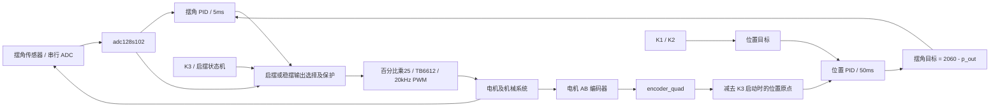

# 倒立摆运行架构与高云移植历史基线

记录日期：2026-10-20。用途：保存重构前的真实运行语义，供后续高云平台底层改写和顶层解耦讨论使用。本轮只读分析 RTL、测试源码、工程配置和本地硬件资料，未修改功能代码，未运行综合、仿真或实机测试。

本文以当前工作区源码为行为依据。旧报告用于解释演变，不把旧报告中已撤销的实现、厂商介绍中的设计设想或队友自述的验证结果视作当前源码的实测结论。

## 阅读入口与来源

| 来源 | 定位 | 本文用途 |
| --- | --- | --- |
| `DLB/DLB/DLB.xpr` | 当前 Vivado 工程，器件 xc7a35tfgg484-2，顶层 Test | 原功能基线 |
| `DLB/DLB/DLB.srcs/sources_1/new/` | 当前控制与外设 RTL | 实际连接、算法和状态时序 |
| `DLB/tests/` | 三个 SV 测试及 PC codec 交叉检查 | 已表达的行为契约与边界 |
| `DLB/FPGA-Monitor/` | Vite、原生 JS、Web Serial、ECharts 上位机 | 调参和观测链路 |
| `lxl/GVIN/Interface_test_new/` | 高云接口测试工程 | 器件、板级接口及参考驱动 |
| `lxl/GVIN/` 下四份 PDF 与一份 PPTX | 套件介绍、上手手册、核心板/底板原理图、功能介绍 | 硬件尺度及设计背景 |
| `lxl/GVIN/J280姿态控制系统开发套件用户手册V1.pdf` | 本轮后续新增，39页 | 完整BANK电压表、按键/LED及板级接口表，核对结果见文末 |
| `C:/Users/MR/Desktop/Temp/FPGA2026/zlx/` | 队友的高云探索 | 适配尝试和已有问题，见后文 |

当前 Git HEAD 为 `d6315ae0e9c1b842c86f5bcb3a206e37361b3285`。开始分析时已存在 `DLB/DLB/DLB.xpr` 修改及未跟踪的 `lxl/GVIN/`，本轮保留它们。

硬件资料页码均指 PDF 文件的物理页序号，包含封面和目录。文中的 `Test.v` 等短文件名，若无说明，指当前 DLB 工程，而非同名的队友版本。

## 1. 先建立整体认识

当前工程是纯 RTL 的自动启摆与双环稳摆控制器。FPGA 中的采样、编码器、UART、PWM、显示同时工作，控制层通过时钟使能和状态条件决定何时更新；不存在 MCU 主循环按函数逐个执行的运行方式。

`Test.v` 同时承担板级接线、毫秒调度、位置坐标管理、启摆状态机、双环控制协调、保护门控、单位转换和遥测冻结。底层已有多个独立模块，但应用控制仍集中在顶层。这就是后续“顶层封装解耦”的实际起点。

两个反馈量必须分清：摆角来自 ADC，位置来自电机编码器。位置环输出用于修正摆角目标；只有摆角环输出和启摆脉冲最终驱动电机。当前没有单独速度环，也没有基于角速度或能量的启摆算法。



图中采样寄存、调度和选择逻辑都在 `Test.v` 内；图中方框不全部对应独立 Verilog 模块。另附 `.drawio` 为可编辑模块关系图。

## 2. 项目地图与模块关系

```text
DLB/
  DLB/DLB.xpr                          Vivado 工程入口
  DLB/DLB.srcs/sources_1/new/          16 个 Verilog 源文件
  DLB/DLB.srcs/constrs_1/new/          Xilinx 引脚与 50MHz 时钟约束
  tests/                              PID 数值、按键、UART/系统测试
  scripts/                            HDL 回归和完整构建脚本
  FPGA-Monitor/src/                    PC 串口、协议、状态、绘图、记录
  IMPLEMENTATION_REPORT.md             多阶段历史记录，以末尾更新为准
lxl/GVIN/
  Interface_test_new/Interface_test.gprj
  Interface_test_new/src/              8 个参考 RTL、2 个 CST
  Interface_test_new/impl/             既有厂商构建产物，非应用源码
  *.pdf / *.pptx / 原理图目录
```

| 文件 / 模块 | 代码行数 | 当前职责和依赖 |
| --- | ---: | --- |
| Test.v / Test | 432 | 系统入口，直接例化以下实际使用模块 |
| adc128s102.v | 84 | 固定通道连续串行采样，输出最近样本及 valid |
| encoder_quad.v | 223 | AB 双同步、四倍频、signed32 累计计数 |
| Key.v / key | 235 | 按键同步、稳定采样及按下/释放事件，顶层例化三个 |
| MyPID.v / PID_Core | 859 | 通用离散位置式 PID，内外环各一个实例 |
| parameter_manager.v | 313 | 六个系数分成两组三寄存器，验证 ID/TYPE |
| protocol_rx.v | 870 | 帧解析、CRC、SET_PARAM，直接调用 uart_byte_rx |
| protocol_tx.v | 1102 | 遥测组帧、CRC、字节发送状态机，直接调用 uart_byte_tx |
| telemetry_param_mux.v | 43 | 将冻结的十二个字段映射到协议索引 |
| uart_byte_rx.v | 417 | 50MHz 波特率表、字节接收 |
| uart_byte_tx.v | 333 | 50MHz 波特率表、字节发送 |
| tb6612_motor_driver.v / TB6612_Motor_driver | 262 | 有符号 PWM 计数转方向/幅值，调用 pwm_gen |
| PWM.v / pwm_gen | 170 | 20kHz 计数器、周期边界锁存 duty |
| Seg8.v | 248 | BCD 转换、扫描、串行移位输出 |
| uart_data_rx.v | 182 | 通用多字节工具，当前不在 Test 实例链 |
| uart_data_tx.v | 162 | 通用多字节工具，当前不在 Test 实例链 |

工程中“添加了源文件”不等于“运行时用到了该模块”。尤其不能把 `uart_data_*` 误加进当前协议的真实链路。文件名和模块名也不完全相同，构建必须按实际模块定义解析。

## 3. 时钟、复位与执行节奏

核心依据：`Test.v:44–160`、`:188–240`、`:340–360`。

| 任务 | 当前节奏 | 用途 |
| --- | --- | --- |
| 系统时钟 | 50MHz，20ns/拍 | 所有控制寄存器的主时钟 |
| ADC 接口 | 后台连续串行帧，SCLK=12.5MHz | 获得最近完整 12 位样本 |
| 基础调度 | 1ms，49999 终值 | 采样快照、状态计时、ADC 年龄 |
| 观察启摆 | 观察态中每40ms | 三点极值与两次中心窗捕获 |
| 角度内环 | 稳摆态每5ms | 扶正摆杆 |
| 位置外环 | 稳摆态每50ms | 约束电机相对位置 |
| 遥测 | 每20ms尝试一次 | 50Hz 观察快照 |
| PWM | 20kHz，2500主时钟计数/周期 | 电机输出 |
| 按键 | 每5ms采样、连续五次稳定 | 约25ms量级消抖，触发单次按下事件 |

1ms/5ms/50ms 都是使能条件，不是三个独立慢时钟。内外环周期只在稳摆期间累计，启摆过程中 PID 不计算。

一次控制更新按以下顺序发生：

1. 在 1ms 边界锁存 ADC、相对位置和两环目标，同时把到期条件寄存到 `angle_tick/position_tick`。
2. 下一主时钟沿，PID 消费已锁存的新输入，更新输出、积分和历史误差，并产生 valid。
3. 输出保持至下一次该环更新；PWM 独立持续运行。

若内外环同时到期，两者并行计算，角度环使用边界前的外环输出构成的目标。新外环结果不会穿透到同次内环；后续毫秒采样将其锁存，下一次5ms内环才消费。这一寄存顺序是重构时需要保留或明确变更的行为。

复位语义并非全部统一：Test/ADC/按键/显示多用异步低有效复位，PID/编码器/PWM 用同步低有效复位。当前不能把 `rst_n` 同名理解为所有模块都有相同的复位释放处理。

## 4. 从上电到自动启摆再到稳摆

核心依据：`Test.v:163–242`。

| 状态 | 含义 | 行为及离开条件 |
| --- | --- | --- |
| 0 | 停止 | 电机无输出；ADC、编码器和遥测继续工作 |
| 21→22 | 正向第一段 | 装入 +35% 和100ms倒计时 |
| 23→24 | 反向第二段 | 改为 −35%，再计时，结束后转1 |
| 31→32→33→34 | 反向起始的对称脉冲 | 先−35%再+35%，结束后转1 |
| 1 | 观察自然摆动 | 输出0，每40ms观察三点极值或中心窗 |
| 4 | 捕获后稳摆 | 双环使能，越过中心窗停止 |

上电默认状态0，目标0、原点0。ADC 至少发布过一个新鲜样本才允许启动。K3 在状态0按下：保存 `position_offset=position_cnt`，转21；在任一非0状态按下：停止。停止后不会自动重启。

状态1保存两次历史样本：三点全在上界外，且中间样本比两边小，触发21；三点全在下界外，且中间样本比两边大，触发31。这是按原始 ADC 数字方向判断的局部极值，物理摆动方向取决于安装与极性。

连续两次相隔40ms的观察样本严格满足 `1560 < ADC < 2560`，进入4，清两环计算历史与周期计数。捕获不检查角速度，也不会重设启动原点或位置目标。第一次观察只建立历史，不能立即把单点当成捕获。

头部注释称双向各100ms，但状态22退出到23后，下一1ms调度才执行换向，所以第一方向实际约101ms、第二方向约100ms；已有集成测试明确接受这一分派延迟。后续若改成精确100/100ms，应当作为行为变化记录，而不是认为只是移动代码。

稳摆时离开严格中心窗，电机输出先由组合门屏蔽，状态机在下一个1ms边界回0。捕获和稳摆使用同一中心窗；旧 TODO 的 `1260/2860` 不是当前源码边界。

## 5. 两个 PID 的数学、数据格式和物理含义

核心依据：`Test.v:18–24`、`:74–87`、`:294–338`，`MyPID.v:357–854`。

```text
外环：e_p = 位置目标 - 相对编码器计数
      p_out = PID_p(e_p)，限幅 ±100 ADC码
内环：a_goal = 2060 - p_out
      e_a = a_goal - ADC角度码
      a_out = PID_a(e_a)，限幅 ±100 电机百分比
执行：PWM计数 = a_out × 25
```

外环输出不是直接电机占空比，而是内环目标偏置。这样位置控制可以通过要求一个小的摆角变化使机械系统回到目标，内环则以更快周期维持直立。两个 PID 独立例化，各自保留积分和上次误差，不共享一套算术状态。

每次触发的原始算法是：

```text
e = target - feedback
I_next = clamp(I + Ki × e, ±I_limit)
sum = Kp × e + I_next + Kd × (e - last_error)
out = clamp(sum, out_min, out_max) >>> 16
```

系数及内部乘积/积分保留 Q16.16，输入目标、反馈和对外输出都是整数。误差33位、差分34位、P/I乘积65位、D乘积66位、内部累加72位，以容纳完整 signed32 输入范围。积分限幅限制的是 I 项贡献，不是误差和。两环 I_LIMIT 均为100。

| 环 | 周期 | Kp RAW | Ki RAW | Kd RAW | 人可读近似值 |
| --- | --- | ---: | ---: | ---: | --- |
| 角度 | 5ms | 19661 | 655 | 26214 | 0.3 / 0.01 / 0.4 |
| 位置 | 50ms | 26214 | 1049 | 262144 | 0.4 / 0.016 / 4 |

这里 Ki、Kd 是本离散公式使用的系数，模块不计算 dt。不能直接把另一份连续 PID 的 Ki、Kd 原封不动写入，也不能改变周期后假定控制效果不变。单次计算的运算量固定；硬件乘法与加法形成组合路径，所以移植时更关键的是组合延迟、DSP映射和时序，而不是软件 O(n) 复杂度。

三个可核对的数值例子：只开 Kp≈0.4、误差+1，输出0；误差−1，输出−1；Ki=0.5、误差持续+1，前两次积分输出依次0、1。原因是内部保留小数，而最终算术右移对负数向负无穷取整，非对称的结果是当前行为。证据见 `pid_numeric_tb.sv:31–45`。

PID 优先级为复位 > clear > disable > tick。clear/disable 清积分和输出，同时同步当前误差以减小重新启动的 D 跳变。Ki 直接改为0不会删除旧积分，但当前 UART 每次合法参数更新都会调用对应 PID 的 clear，因此经串口改参会清该环历史。clear 与 tick 同拍时本次计算被抑制。

当前已撤销早期“小数目标/小数输出接口与内部流水”扩展，不能把遥测 Q16.16 标签当成 PID 内核保留小数输出的证据。

## 6. 坐标、按键、执行器和保护边界

编码器 A/B 各两级同步，默认 `00→01→11→10→00` 每次合法变化+1，反序−1，非法跨相跳变不计数。编码器自身是 signed32 累计值，顶层零点输入固定0。

`relative_position = position_cnt - position_offset` 使用33位减法并向signed32饱和。K3每次从停止启动时更新原点；停止保留原点、目标，捕获也保留它们。因此启摆运动引起的位置变化完整进入外环。差值饱和不能阻止底层累计计数器长时间运行后回绕。

K1/K2 每次有效按下目标±34，目标限制±4080；同时触发二者不变，长按不连续重复。34来自旧机构 `408/4/3` 的计数尺度，代码并不把计数转换为角度。换成1040 count/圈机构时，机械意义将改变，不能只改注释。

数码管数据为 `run_state*10000 + abs(position_sample)%10000`，左四位状态，右四位相对位置绝对值。不显示正负，超过四位取模。该显示表达式包含取模与组合 BCD 转换，虽然属于观察路径，仍会影响整工程综合时序。

电机层输入是 signed16 PWM计数，符号定方向，绝对值限制到2500；顶层把百分比乘25。默认编码器反向参数0、电机反向参数1。失能/零命令输出 IN1=IN2=PWM=0；主动刹车接口在顶层固定关闭。STBY 不由当前顶层控制。

`pwm_gen` 在周期起点锁存占空比，减少 duty 更新毛刺，但方向组合跟随命令符号，当前没有统一的周期边界换向，也没有换向死区逻辑。

当前保护实际提供：上电停止、ADC未就绪不启动、约3个毫秒年龄的失鲜门控、K3停机、稳摆中心窗越界停机。ADC年龄监视的是驱动 valid，不等价于模拟传感器健康：驱动即使接到恒定错误码仍可能持续 valid。启摆允许在中心窗外输出；状态1没有等待超时；未实现编码器失效检测、位置越界停机或独立故障码/FAULT锁存状态。±4080只是目标限幅。

## 7. 通信、遥测与上位机

当前 UART 为115200/8N1。协议真实链路是 `protocol_rx/tx → uart_byte_rx/tx`；底层分频表绑定50MHz。

```text
A5 5A | VER=01 | MSG_TYPE | SEQ(2) | LEN(2) | PAYLOAD | CRC16(2)
```

多字节小端；CRC16/MODBUS 初值FFFF、多项式A001，覆盖VER至PAYLOAD。遥测类型01，payload为 COUNT 加若干 `ID(1)+TYPE(1)+VALUE(4)`；SET_PARAM类型10，payload为单个六字节参数，整帧16字节。

| ID | 内容 | 类型 | 允许串口写入 |
| --- | --- | --- | --- |
| 01 / 02 / 03 | a_goal / a_real / a_set | Q16.16 / INT32 / Q16.16 | 否 |
| 04 / 05 / 06 | p_goal / p_real / p_set | INT32 / INT32 / Q16.16 | 否 |
| 10 / 11 / 12 | 角度 Kp / Ki / Kd | Q16.16，TYPE03 | 是 |
| 20 / 21 / 22 | 位置 Kp / Ki / Kd | Q16.16，TYPE03 | 是 |

每20ms且TX空闲，Test同拍冻结十二项字段，下一拍启动发送。12项形成83字节帧，纯线上发送约7.2ms；忙时该次发送机会跳过，无排队补发。TX模块本身逐参数锁存，跨参数整帧一致性由顶层frame寄存器保证。

这是一份观察时刻快照：ADC最新值、最近PID输出和当前系数各有不同更新节奏，并非所有字段都对应同一次PID计算。a_goal/a_set/p_set只是把整数左移16位编码，所以显示成Q格式也不会恢复算法已取整的小数。

接收校验合法后，参数管理器更新对应系数，并通过 update_done 在下一拍清对应PID；之后等待该环下一周期再计算。六个系数逐帧独立生效，不存在三系数一组原子提交。UART只控制系数，不控制启动、目标位置、中心码或控制周期。

PC接收路径：`SerialTransport → ProtocolDecoder → ChannelStore → Chart/UI/HistoryStore`。发送路径：`ParameterController → ValueCodec → ProtocolEncoder → SerialTransport`。参数转换只由ValueCodec负责，通道按ID自动发现，显示名称、单位、颜色与可写性由ConfigStore配置。图表刷新和串口接收解耦，记录使用IndexedDB。

当前无ACK、GET_PARAM、COMMAND或自动重发。PC通过后续遥测 TYPE+RAW 与请求一致标记同步，只表示系数回读相等。波形时间是主机完整帧接收时间，不是板端采样时间戳。

## 8. 高云套件：已确认事实和参考源码边界

`Interface_test.gprj:6` 指定 `GW2A-LV55PG484C8/I7`，与介绍手册第4页吻合；参考工程使用50MHz，核心板原理图亦有50M时钟。PPT第4页描述的是水平旋转摆臂和自由摆杆构成的旋转倒立摆，和旧工程中“小车位置”的文字不能直接混为同一个机械坐标。

| 项目 | 旧 DLB | 高云资料与接口例程 |
| --- | --- | --- |
| FPGA工具/约束 | Vivado / XPR / XDC | Gowin EDA / GPRJ / CST，时序另用SDC |
| ADC | ADC128S102，12位串行 | 3PA1030，10位并行 |
| 角度传感器 | 原项目传感器及中心2060 | WDD35D4，须重新标定中心/方向 |
| ADC输出节奏 | 高频完整帧 valid | 官方例程每3ms输出16点均值，无valid端口 |
| 编码器基准 | 按键语义按408 count/圈 | 文档13线×20减速，四倍频推算1040 count/圈 |
| 电机 | 单路TB6612控制 | MG531，TB6612FNG双路，XH1/XH2 |
| UART | 115200、Protocol V1、双向系数 | 接口例程9600、AA55简单遥测 |
| 显示 | 外接595数码管链路 | 当前套件资料未给出同样显示接线 |

介绍手册第11–13页给出13线、20减速和260脉冲/输出轴圈；1040来自与四倍频解码联合推算，仍需手转一圈实测。编码器5V供电不自动代表FPGA输入是5V，须沿电路核实。

介绍手册第14–17页给出WDD35D4、3PA1030、10位、最高50MSPS、ADC模拟范围0–2V。参考 `adc.v` 将10位左移2形成12位尺度，每187.5µs取一点、3ms平均16点，约333Hz输出。左移不增加硬件分辨率，平均及噪声可能产生更细输出码，但不能称为12位ADC。

`top.v` 在上传路径另加135，且每250ms锁存一次，变量名却叫cnt_500ms。上手手册第9页要求自然下垂显示约990–1040，这是带软件处理的观察值，不能直接指定新的直立中心仍为2060。

官方 `top.v` 两路电机共用方向，duty固定60，ADC/编码器只用来上传，不闭合PID。`motor_ctrl.v`实际周期5400，约9.259kHz；duty60映射1200计数，约22.22%，不是注释中的10kHz或60%。UART帧为 `AA 55 + 角度16位 + 编码器1/2各16位 + 0D 0A`，数值高字节先发，无CRC，RX未参与业务。

上手手册第15–16页另行介绍手动扶正的 `PID_Control.fs`；本地现有文件未提供该闭环设计的可读RTL。PPT列出的角速度、滤波、PID、限位是设计介绍，不能当作接口例程已实现功能。

引脚参考以GPRJ启用的 `fo_rip_top.cst` 为准，另一份 `AD_test.cst` 未启用且信号/电机B方向映射有差异。现有CST遗漏 `adc_stby_n` 和 `test`；既有PNR把它们自动放至T6/T5、BANK6、LVCMOS18。`test`本身无驱动，`adc_otr`也未实际接入。这些是板级封装需要厘清的遗留项。

上手手册第7页说明BANK0/1/4跳帽分别2.5/3.3/3.3V；按键CST为BANK3的LVCMOS15，不能误判为与BANK0跳帽冲突。其它BANK供电要按完整核心板资料核对。ADC的STBY命名、注释极性和固定电平存在歧义，须核对实际芯片引脚及板上连接，不能照名称推断。

## 9. 队友 zlx 探索：补充记录

来源为工作区外只读目录 `C:/Users/MR/Desktop/Temp/FPGA2026/zlx/`；本轮未向该目录写入文件。

根目录提供了保留旧控制逻辑的 `Test.v`、改为并行ADC但沿用旧名的 `adc128s102.v`、`DLB.cst`及引脚说明。它与官方纯接口例程不同，属于把现有闭环工程接到高云硬件的适配尝试。

该Test把ADC_DOUT扩为 `[9:0]` 并将ADC实例参数改成CLK_DIV；K1/K2步进34、限幅4080、中心2060、5/50ms周期和双PID结构仍保持原值。文件注释“现为九位”不准确，`[9:0]`是10位。

新ADC每3ms发布一个均值valid，输出保持12位尺度；ADC_SCLK实际25MHz，ADC_CS_N被借名当OE，ADC_DIN被借名当STBY。保留旧名能减少连接改动，却掩盖了接口协议已从串行改为并行；后续解耦应明确真实的物理接口与统一的样本接口。

队友说明记录了50MHz时序不满足、Fmax约21.98MHz、117个建立时间违规端点、TNS约−826ns，路径由位置显示 `%10000` 和BCD转换引起。这是队友文档自述，本轮尚未取得其所指完整工程/报告并重新复现，不能作为本次已验证结果。它说明显示与控制虽逻辑独立，综合关键路径仍可能由显示层决定，值得后续优先核对。

### 9.1 新 ADC 与旧保护的周期冲突

`zlx/adc128s102.v:61–68` 每3ms发布valid，而未改变的 `zlx/Test.v:61` 仍以 `adc_age < 3` 判定新鲜。两者同步复位、计数同相，逐拍推导如下：

| 50MHz边沿 | ADC动作 | 顶层看到的旧信号及结果 |
| --- | --- | --- |
| 150000（3ms） | 本拍才将valid置1 | 顶层看到旧valid=0，尚未消费首样本 |
| 150001 | valid恢复0 | 顶层消费旧valid=1，ready置1、age清0 |
| 200000 / 250000 | 尚未到3ms更新边界 | age分别增为1、2 |
| 300000（6ms） | 本拍才发布下一valid | 顶层看到旧valid=0，age从2变3，sensor_ok变0 |
| 300001 | valid恢复0 | 顶层虽把age清0，状态机仍读到边沿前sensor_ok=0而停机 |

因此该并行适配会周期性关闭使能，并清零运行状态；不能只凭样本平均值正确就认为接口已兼容。以上是静态RTL时序推导，未运行仿真。后续需要同时定义刷新上限、滤波延迟、valid消费时刻与超时裕量。本轮不改代码。

队友ADC的CLK_DIV参数仅声明、没有参与分频，实际始终25MHz。其STBY工作电平1与官方例程固定0相反，且队友CST没有约束该端口，不能认定任一版本正确驱动了实物STBY。

### 9.2 引脚整理与独立练习

队友CST中时钟M19、复位AB3、串口K20/L20、ADC数据/时钟/OE和电机A/编码器XH1映射与官方启用CST一致。它记录SW4=T20的SSPI专用脚报错，并取消该未使用输入的约束。ADC_DIN与数码管三输出仍未约束；自动分配位置不能作为最终接线方案。

说明表格正确列出复位AB3/BANK5/3.3V，但后文又把SW5复位笼统归到BANK3/1.5V，自相矛盾。应区分复位和SW1–4所在BANK，不能照抄该段文字。队友目录仅提供根目录四文件及独立实验，缺少说明中引用的DLB.gprj/DLB.sdc/impl报告，不能单独视为完整倒立摆工程。

| 独立练习 | 实际内容 | 与倒立摆底层的关系 |
| --- | --- | --- |
| fpga_gowin/adc | 单比特串行ADC、12位数据与通道地址 | 不是J280并行ADC；data有两个always驱动等问题，TB仅激励 |
| led_key及重复目录 | led=~key组合映射 | 不提供同步/消抖/按下事件，不替代当前Key模块 |
| fpga_gowin/timer | 一次计时完成后flag保持1 | 不是周期单拍tick，不可直接替代调度器 |
| fpga_gowin/uart_tx | 默认9600，每秒自动发送输入数据 | 不同于Protocol V1的受控字节发送 |
| fpga_gowin/uart_tx1 | send启动，约9600，无busy接口 | 发送中send会修改数据，握手契约不足 |
| fpga_gowin/uart_rx | 9600同步/下降沿检测/中点采样 | 停止位错误等边界未完整处理，未见配套自检TB |

独立练习的测试多以波形观察为目的，不能用文件名“tb”推定已自动检查全部功能；其中串行ADC测试也不覆盖根目录新并行ADC及其与watchdog的集成。可参考的成果是引脚整理、并行采样适配思路和已有问题线索。

## 10. 历史演变与验证范围

`IMPLEMENTATION_REPORT.md` 保留多次实现记录，读取时必须结合后续“取代上一节”说明：

1. 最初位置环20ms调参例程不是当前完整倒立摆。
2. 后续加入自动启摆和双环，曾扩展PID为小数接口及内部流水。
3. 再后恢复原版PID，两实例独立、整数串级。
4. 最后固定K3启动前原点、捕获不改原点，并将外环Ki设为1049。

旧 `lxl/FPGA倒立摆移植TODO.md` 是更早STM32/ACX720规划，含1/5/50ms及1260/2860等另一组基线，不取代当前Test。旧报告引用的 `PID_UART_README.md` 当前清单未见，不能将失效文档链接当作已读依据。

已有测试源码表达了以下契约，本轮仅审读，未重新运行：

| 测试 | 覆盖意图 | 不覆盖的事实 |
| --- | --- | --- |
| pid_numeric_tb.sv | 原版PID整数级联、负数右移、INT32误差、积分小数/限幅、clear/disable | 不证明机械稳定性 |
| pendulum_keys_tb.sv | 真实按键输入、消抖、长按、启停/重启原点、ADC失鲜 | 不证明真实按键电气或板级时序 |
| pid_uart_tb.sv | ADC行为模型、物理UART位、周期/启摆/捕获、调参拒收、遥测冻结 | 无实际机械动力学，部分状态/事件用force加速 |
| check_pid_uart_codec.mjs | HDL捕获数据与上位机真实codec互查 | 依赖已有仿真输出，不是实机联调 |

最新历史报告曾记录Xilinx 50MHz完整构建通过及setup约0.200ns，且明确未下载实机。这既不是高云结果，也不是本轮重新验证。外部IO延迟约束与模拟链路仍有独立验证边界。

## 11. 后续重构讨论应携带的接口契约

本节是从现状提取的边界，未决定新目录或实施方案。

| 边界 | 需要明确的契约 | 原因 |
| --- | --- | --- |
| 板级封装 → 外设 | 器件、引脚、BANK电压、复位、真实ADC协议 | XDC不能直接转换成CST后就认为移植完成 |
| 采样 → 控制 | data/valid、刷新上限、超时、滤波延迟、码值尺度 | 现保护依赖样本新鲜度，3ms均值与旧SPI不同 |
| 编码器 → 坐标 | 计数方向、每圈计数、signed位宽、启动原点 | 408与1040会改变目标与控制参数量纲 |
| 调度 → PID | 5/50ms、快照先于tick、同拍两环顺序 | 改变时序等于改变离散控制系统 |
| PID → 执行器 | ADC码修正 / 百分比 / PWM计数分别是什么 | 不能把外环输出当作电机输出 |
| 控制 → 电机 | 启摆/稳摆选择、保护优先级、方向/饱和/换向 | 多处符号与使能共同决定反馈方向 |
| 控制 → 观测 | 十二项冻结、忙时丢周期、显示可替换 | 移除或替换显示不应改变控制行为 |
| 参数入口 → 控制 | 六ID、Q16.16、clear及分项更新语义 | 原有上位机可继续兼容的关键 |

两个迁移场景可帮助检验理解：换为高云板载并行ADC，应改变物理采样实现及其时序/滤波约定，而控制层仍可消费完整样本；移除外接数码管、只留UART，应改变观察输出而保持PID输入、tick、启摆状态与电机命令一致。两种情况都需要明确哪些变化是平台适配，哪些是有意改变控制行为。

后续不能直接继承的数字包括2060、±500、34、±4080、±35%、100ms、PID系数以及百分比乘25；它们分别关联标定、机械尺度、启摆能量和时钟/PWM频率。先保存原行为，再讨论新行为及实物验证。

## 12. 本轮理解状态

已从源码追踪顶层实例、启摆各分支、双环数值与时序、坐标和按键、输出保护、通信与PC路径；已读高云接口源文件、工程/约束、PDF文本和PPT文字，并对队友资料作独立来源记录。原理图文本能确认芯片和网络名，但不足以证明完整电气路径，未把模糊模拟网络或STBY极性当作确定结论。

当前能够据此解释系统如何运行、明确重构要保留的行为并指出平台相关耦合；尚不能证明实物能启摆稳摆、ADC中心与极性正确，或高云50MHz时序满足。下一轮应在本基线之上讨论底层改写及顶层职责拆分，而无需再从历史报告推测当前版本。

## 13. 新增用户手册V1核对：按键、LED及BANK电压

2026-10-20后续补充：已读取新增39页用户手册的文本，渲染并目视核对按键/复位和LED两页电路图。本节补充前文当时缺少的完整核心板资料，不修改RTL或约束。

| 内容 | 手册正文页码 | PDF物理页码 | 位置 |
| --- | ---: | ---: | --- |
| BANK电压 | 11 | 15 | 3.2.3 |
| 按键、复位、拨码 | 13 | 17 | 3.2.5 |
| LED | 14 | 18 | 3.2.6 |
| UART | 15 | 19 | 3.2.7 |
| ADC | 21 | 25 | 3.3.2 |
| 电机驱动/编码器 | 22–23 | 26–27 | 3.3.3–3.3.4 |

电源总表明确BANK2/BANK5为3.3V，BANK3/BANK6/BANK7为1.5V；BANK0可2.5/1.2V，BANK1/BANK4可3.3/2.5V，后两者仍须结合实际跳帽。

| 资源 | FPGA引脚 | BANK / 按电源表采用的IO标准 | 有效电平 |
| --- | --- | --- | --- |
| SW1 / SW2 / SW3 / SW4 | T18 / R18 / U20 / T20 | BANK3，LVCMOS15 | 按下0、松开1 |
| SW5 / RST_N | AB3 | BANK5，LVCMOS33 | 低有效复位 |
| 两位拨码B3_SW1 / B3_SW2 | W20 / V20 | BANK3，LVCMOS15 | 按图ON接地为0，断开上拉为1 |
| FPGA_LED1 / 2 / 3 / 4 | U18 / U19 / U17 / T17 | BANK3，LVCMOS15 | 1亮、0灭 |

LED页原理图显示FPGA信号进入MM3904三极管，三极管控制由3.3V供电的LED支路。LED供电3.3V不等于该BANK的FPGA输出标准为3.3V。因此按键与LED可用 `led = ~key` 实现按下点亮，仍需端口数量和物理约束对应实际四路资源。

手册本身存在两处电压标注矛盾：按键表把SW5写成1.5V，但同页复位芯片由3.3V供电，且电源总表BANK5为3.3V；LED表写3.3V，但四路引脚归BANK3，电源总表为1.5V。综合电源表与原理图，约束应分别按复位LVCMOS33、BANK3按键/LED用LVCMOS15处理，后续上板仍应以实际板卡供电核对。不能仅据单页IO电平列照抄。

手册列出了SW4=T20，但这只确认板上连接，不取代队友记录的SSPI复用配置问题；能否作为普通IO还需Gowin工程对应设置。UART表网络名与描述列仍有方向歧义，保留官方例程与电路交叉核对的要求。ADC表只列CLK/OE/D0–9/OTR，没有列出独立可控STBY，未消除旧接口借名的歧义。

## 14. 电机实机排查补充：连接器与桥通道不可混用

2026-10-20后续用户反馈：当前顺时针转动时编码器读数减小；先记录，未反转解码参数。`enc=-17,delta=+0,pwm=-1250`表明串口已接受命令，但这些窗口没有检测到位移；pwm遥测不是物理PWM测量。

进一步目视核对`Balance_Ctrl_20260618.pdf`第1页发现，U4的AO1/AO2接O3/O4，BO1/BO2接O1/O2；XH1接O1/O2及编码器1A/1B，XH2接O3/O4及2A/2B。因此按该版原理图，**XH1电机接TB6612 B桥，XH1编码器仍接1A/1B**。这修正前文及早期测试说明中“XH1=A桥”的推断，不应因官方例程同时驱动两桥而忽略此区别。

tb6612_encoder测试工程已把电机三输出CST改为PWMB=V14、BIN1=AA17、BIN2=V15，编码器仍为Y20/AA20。旧电机/PWM/编码器模块不变；需要用户重新下载，并结合实际PCB版本确认电机是否恢复运动。逻辑板拔USB仍运行不能单独证明电机驱动VM供电存在。

## 15. 实机确认后的固定方向：顺时针为正

2026-10-20用户确认：修正XH1桥通道后电机已能旋转；但反转参数均为0时，顺时针对应负PWM、编码器计数减小。按用户明确要求，tb6612_encoder顶层现将MOTOR_DIR_REVERSE和ENCODER_DIR_REVERSE同时设为1，后续高云工程沿用：正PWM驱动顺时针、顺时针使enc增加且窗口delta为正；逆时针对应负PWM、enc减小、delta为负。顺时针视角沿用本次实机观察视角。

这取代前文“仅记录、不反转”的当前适配结论，但保留历史DLB源码事实。仅修改高云测试顶层默认参数及配套说明/测试期望，不修改旧驱动、编码器、PWM、UART或XH1 B桥约束。enc是位置，当前顺时针运动不等于enc本身必为正数。新默认值需要重新下载后才生效。
